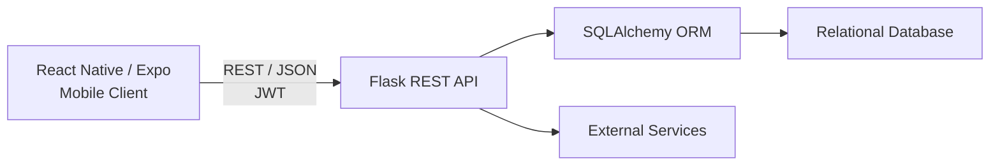
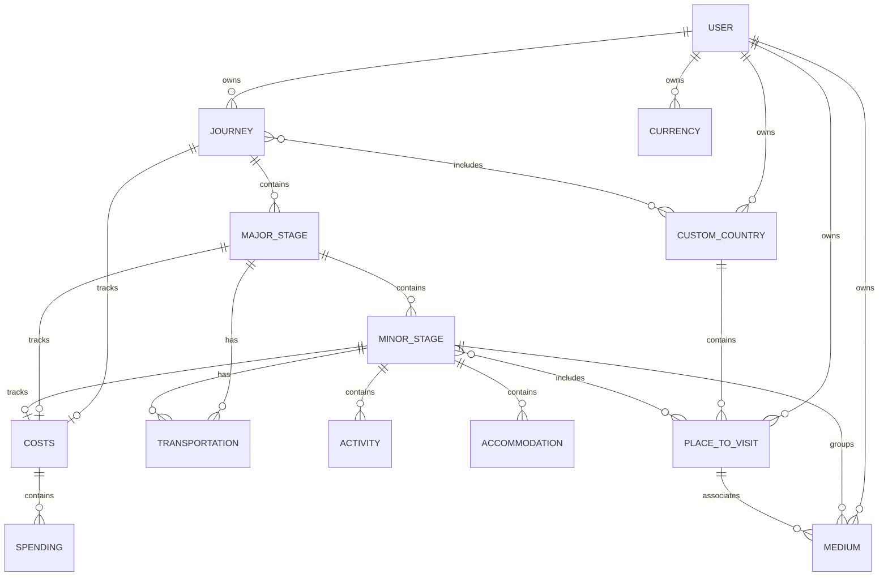

# TravelBuddy Backend

**REST API for the TravelBuddy mobile travel planning application.**

This repository contains the Python backend for TravelBuddy. It provides the REST API, authentication, relational data model and business logic used by the React Native mobile client.

The backend is built with **Flask** and **SQLAlchemy** and supports complex multi-stage journeys including destinations, transportation, accommodation, activities, expenses, currencies and travel media.

**Frontend Repository:**  
[TravelBuddy Frontend](https://github.com/Meilocora/TravelBuddy-frontend)

---

## Architecture

The backend acts as the central API and persistence layer of TravelBuddy.



The mobile client communicates with the backend through JSON-based REST endpoints. Authentication is handled with JWT access and refresh tokens.

---

## Tech Stack

| Area                | Technology                                         |
| ------------------- | -------------------------------------------------- |
| **Language**        | Python 3.12                                        |
| **Web Framework**   | Flask                                              |
| **ORM**             | SQLAlchemy 2 / Flask-SQLAlchemy                    |
| **API**             | REST / JSON                                        |
| **Authentication**  | JWT access & refresh tokens (PyJWT), bcrypt        |
| **Database**        | PostgreSQL (Docker), SQLite (tests)                |
| **Geo & Currency**  | geopy, timezonefinder, countryinfo, CurrencyConverter |
| **Testing**         | pytest, pytest-cov                                 |
| **Static Analysis** | Ruff                                               |
| **CI**              | GitHub Actions                                     |
| **Deployment**      | Docker, Docker Compose, Gunicorn                   |
| **Configuration**   | python-dotenv                                      |

---

## Domain Model

TravelBuddy uses a hierarchical relational model designed around complex multi-stage journeys.



This structure allows costs, transportation, activities, accommodation, places and media to be associated with the appropriate level of a journey.

---

## API Structure

The API is separated into Flask blueprints based on domain responsibilities.

| Resource       | Base Route        |
| -------------- | ----------------- |
| Authentication | `/auth`           |
| Users          | `/user`           |
| Journeys       | `/journey`        |
| Major Stages   | `/major_stage`    |
| Minor Stages   | `/minor_stage`    |
| Countries      | `/country`        |
| Places         | `/place-to-visit` |
| Transportation | `/transportation` |
| Activities     | `/activity`       |
| Spendings      | `/spending`       |
| Media          | `/medium`         |
| Currencies     | `/currency`       |

The individual routes provide CRUD operations as well as domain-specific actions such as stage reordering, resource linking and travel-related data processing.

---

## Authentication & Authorization

TravelBuddy uses JWT-based authentication with separate access and refresh tokens.

Protected routes determine the authenticated user from the token rather than accepting a user ID supplied by the client.

### Resource Ownership

Authorization is enforced at resource level.

Ownership checks ensure that authenticated users can only access or modify resources belonging to their own account.

This includes both directly owned resources and nested resources such as:

```text
User
└── Journey
    └── MajorStage
        └── MinorStage
            ├── Activity
            ├── Accommodation
            └── Transportation
```

Related-resource validation also prevents a user from linking one of their own resources to an object owned by another account.

Ownership validation covers, among others:

- journeys
- major and minor stages
- activities
- transportation
- places and custom countries
- media
- currencies
- costs and spendings
- bulk operations
- reorder operations

Foreign resources are treated as unavailable rather than exposing whether an object belonging to another user exists.

---

## Testing

The backend uses **pytest** for automated testing. The suite exercises every
blueprint through Flask's test client, including success paths, validation
failures, missing resources and database errors.

Each test runs against its own **in-memory SQLite database**, so tests are
isolated from each other and never touch a development or production database.

### Test structure

| File                              | Purpose                                                          |
| --------------------------------- | ---------------------------------------------------------------- |
| `tests/conftest.py`               | App, client and auth fixtures, plus shared test data             |
| `tests/helpers.py`                | `field()`, `raise_error()` and `stub_validation()` helpers       |
| `tests/test_<resource>_routes.py` | Endpoint tests per blueprint, grouped by endpoint                |
| `tests/test_resource_access.py`   | Unit tests for the ownership-aware lookup helpers                |
| `tests/test_authorization.py`     | Ownership checks for delete endpoints                            |
| `tests/test_security_regressions.py` | Regression tests for cross-account access                     |

Two fixtures provide test data:

- `route_graph_data` – one user with a fully populated journey (stages, costs,
  country, place, activity, spending, transportation, medium, currency)
- `ownership_data` – two users with identical resource trees, used to verify
  that one user cannot access the other user's data

Validators are stubbed with `stub_validation()` where a test targets route
behavior rather than validation rules. Known bugs are documented with
`pytest.mark.xfail(strict=True)`, so the test starts failing as a reminder
once the bug is fixed.

### Authorization regression tests

A particular focus is placed on authorization and ownership boundaries.

Regression tests cover scenarios such as:

- accessing or deleting another user's resources
- modifying foreign nested resources
- reordering stages belonging to another user
- linking media to foreign resources
- creating places for foreign countries
- modifying child objects through unrelated parent resources
- preventing updates to one journey from affecting another journey

### Run all tests

```bash
python -m pytest -v
```

### Run tests with coverage

```bash
python -m pytest --cov=app --cov-report=term-missing
```

---

## Code Quality & Continuous Integration

**Ruff** is used for static code analysis and helps detect problems such as:

- undefined variables
- unused imports and variables
- unsafe exception handling
- common Python mistakes
- maintainability issues

Run Ruff locally:

```bash
ruff check .
```

GitHub Actions automatically executes code-quality checks and the automated test suite for repository changes.

This ensures that code quality checks and tests also pass in a clean environment independent of the local development setup.

---

## Project Structure

```text
TravelBuddy-backend/
├── app/
│   ├── routes/
│   │   ├── *_routes.py           # One Flask blueprint per resource
│   │   ├── resource_access.py    # Ownership-aware lookups (get_user_*)
│   │   ├── route_protection.py   # @token_required decorator (JWT check)
│   │   ├── db_util.py            # Shared queries, stage ordering and date recalculation
│   │   └── util.py               # Date parsing, cost calculation, geo and currency helpers
│   │
│   ├── validation/               # Form validation per resource
│   └── models.py                 # SQLAlchemy models
│
├── tests/
│   ├── conftest.py               # Fixtures and shared test data
│   ├── helpers.py                # Test helpers
│   └── test_*.py
│
├── .github/
│   └── workflows/tests.yml       # Ruff + pytest CI
├── .env.example
├── db.py                         # SQLAlchemy instance
├── server.py                     # App factory (create_app) and dev server
├── Dockerfile
├── docker-compose.yml
├── Procfile                      # Gunicorn start command for PaaS hosting
├── requirements.txt
├── requirements-dev.txt
└── LICENSE
```

---

## Getting Started

### Run locally with Docker Compose

Install Docker Desktop (with the Docker Compose plugin), then run these commands
from the repository root:

```bash
cp .env.example .env
```

In `.env`, replace `SECRET_KEY` with a long random value and set
`POSTGRES_PASSWORD` to an alphanumeric password. Set `GOOGLE_API_KEY` if you
use features that require it. Compose builds the database connection string
itself; `SQLALCHEMY_DATABASE_URI` in `.env` is used only when running Python
directly on your machine.

For a new, empty local database only, create the tables once:

```bash
docker compose run --rm api python -c "from server import create_app; from db import db; app = create_app(); app.app_context().push(); db.create_all()"
```

Start the API and database:

```bash
docker compose up --build -d
docker compose logs -f api
```

The API listens on http://localhost:5001. To stop the services, run
`docker compose down`. The named PostgreSQL volume preserves your data.
`docker compose down -v` also deletes that local database volume.
`db.create_all()` creates missing tables but does not update existing tables.
No migration tool is configured yet, so schema changes to existing tables must
be applied manually when the models change. This Compose setup
uses a separate local database; it does not copy data from an existing database.
The database is reachable by the API through the Compose hostname `db` and is
not exposed to the host machine.

For Expo running on a physical phone, configure the frontend API address to
your computer's LAN address instead of `localhost`.

### Run without Docker

#### Prerequisites

- Python 3.12+
- pip
- A database supported by SQLAlchemy (e.g. PostgreSQL, or SQLite for quick local tests)

#### Clone the repository

```bash
git clone https://github.com/Meilocora/TravelBuddy-backend.git
cd TravelBuddy-backend
```

#### Create a virtual environment

```bash
python -m venv venv
```

Windows:

```bash
venv\Scripts\activate
```

macOS / Linux:

```bash
source venv/bin/activate
```

#### Install dependencies

```bash
pip install -r requirements.txt
```

For development, testing and linting:

```bash
pip install -r requirements-dev.txt
```

#### Environment configuration

Create a local `.env` file based on the provided example:

```bash
cp .env.example .env
```

Configure the required environment variables:

```env
GOOGLE_API_KEY=your_google_api_key
HOST=127.0.0.1
SECRET_KEY=your_secure_secret_key
SQLALCHEMY_DATABASE_URI=your_database_connection_string
FLASK_DEBUG=false
PORT=5001
```

Secrets and credentials are intentionally excluded from version control.

#### Run the backend

```bash
python server.py
```

The API will then be available using the configured host and port. On startup,
`server.py` creates missing database tables automatically.

For a production-like run, use Gunicorn (as in the `Dockerfile` and `Procfile`):

```bash
gunicorn --bind 0.0.0.0:5001 "server:create_app()"
```

---

## Security Notes

- Secrets are loaded from environment variables and are not committed to the repository.
- Protected endpoints require valid authentication.
- Resource ownership is verified server-side.
- Client-provided foreign keys are validated before relationships are created or modified.
- Database transactions are rolled back when write operations fail.
- Authorization behavior is covered by automated regression tests.

---

## Project Status

TravelBuddy is a personal full-stack portfolio project focused on building and refining a realistic mobile application architecture.

The core API, relational data model, authentication, resource-level authorization and automated security tests are implemented.

Current development focuses primarily on:

- maintainability
- code quality
- testing
- documentation
- API consistency

The project is not currently operated as a production commercial service.

---

## Related Repository

The React Native / Expo mobile application is available here:

**[TravelBuddy Frontend](https://github.com/Meilocora/TravelBuddy-frontend)**

---

## License

This project is licensed under the [MIT License](LICENSE).
